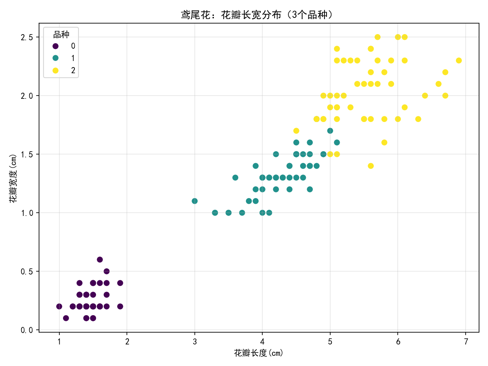

# 鸢尾花品种分类｜机器学习多分类实战
> 数据科学与大数据技术 | Scikit-learn KNN近邻算法项目
经典入门机器学习项目，根据花的萼片、花瓣尺寸特征，完成3种鸢尾花的品种分类，完整流程：数据读取、数据集导出、训练测试集划分、KNN模型训练、模型评估、可视化。

## 数据集介绍
数据集文件：`data/iris_dataset.csv`
sklearn内置经典鸢尾花数据集，一共150条样本，3类花朵，每类50条
- sepal length (cm)：萼片长度
- sepal width (cm)：萼片宽度
- petal length (cm)：花瓣长度
- petal width (cm)：花瓣宽度
- target：品种标签（0:山鸢尾，1:变色鸢尾，2:维吉尼亚鸢尾）

## 技术栈
Python Pandas、NumPy、Matplotlib、Scikit-learn

## 项目流程
1. 加载鸢尾花数据，导出保存为本地csv文件
2. 特征与标签分离，按8:2划分训练集与测试集
3. K近邻(KNN)分类模型训练
4. 使用准确率、混淆矩阵评估分类效果
5. 绘制花瓣长宽散点图，可视化三类样本分布

## 项目结果
- 准确率：模型预测正确样本占总样本比例
- 混淆矩阵：查看各类样本的错分情况

## 预览图


## 运行依赖与启动
```bash
pip install pandas numpy matplotlib scikit-learn
python iris_classify.py
